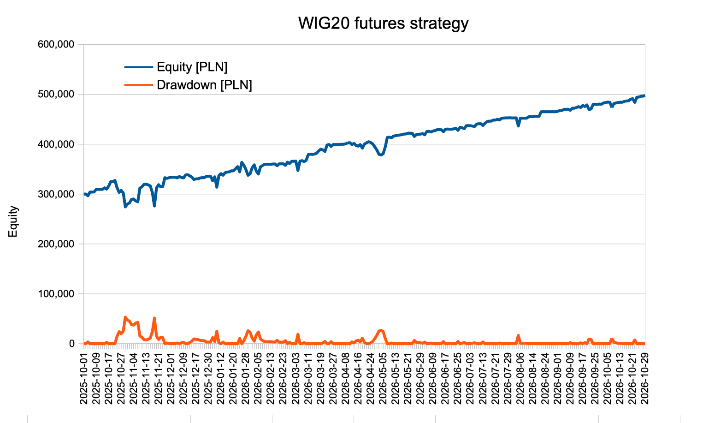
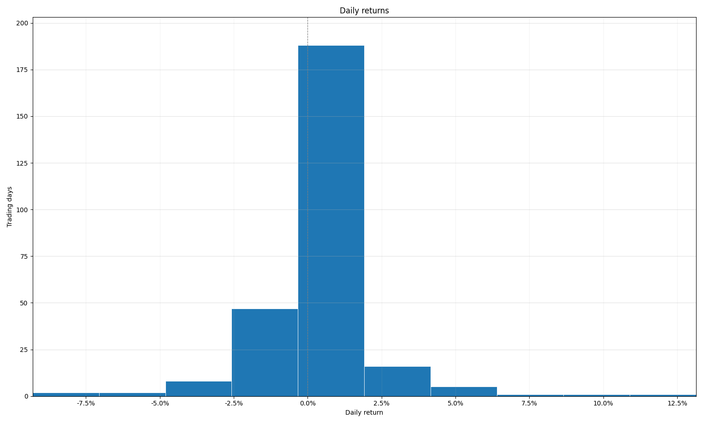

# Strategy description

Systematic strategy which identifies trending opportunities where a SVM regression, xgboost, neural network predicts whether a trend continues, paired with a regime-detection model to turn signals off or adapt during choppy, mean-reverting markets. Discretionary component acts as a macro risk circuit breaker.

The strategy achieved a **65%+ live return** over the last 12 months by exploiting trends, reversals and micro-structural gaps with overnight size reductions.

## Goal

While validated on CEE equity derivatives (with smaller HFT component, larger structura inefficiencies), the strategy is a starting point to its risk-return metrics (Sharpe) and scale up.

The research framework is built to scale across broader EMEA futures (and other asset classes).

# Strategy metrics (after commissions)

| Metric             | Value          |
| ------------------ | -------------- |
| Start date         | 1. Oct 2025    |
| Last date          | 27. Oct 2026   |
| Starting capital   | 300,000.00 PLN |
| Final equity       | 497,609.00 PLN |
| Total PnL          | 197,609.00 PLN |
| Total PnL (%)      | 65.9%          |
| Returns volatility | 0.019305       |
| Sharpe ratio       | 1.75           |
| Sortino ratio      | 2.8            |
| Max drawdown       | 53,127.50 PLN  |
| Max drawdown (%)   | 16.2%          |
| Open position      | 0 (flat)       |
| Transactions       | 1,432          |
| Trading days       | 271            |

## Appendix

### Returns histogram

### Equity, drawdown timeseries

| Date | Equity [PLN] | Drawdown [PLN] |
| --- | ---: | ---: |
| 2025-10-01 | 300,000 | 0 |
| 2025-10-02 | 300,130 | 0 |
| 2025-10-03 | 296,602.5 | 3,527.5 |
| 2025-10-06 | 303,990 | 0 |
| 2025-10-07 | 303,990 | 0 |
| 2025-10-08 | 304,305 | 0 |
| 2025-10-09 | 309,450 | 0 |
| 2025-10-10 | 309,450 | 0 |
| 2025-10-13 | 309,450 | 0 |
| 2025-10-14 | 309,450 | 0 |
| 2025-10-15 | 312,565 | 0 |
| 2025-10-16 | 309,912.5 | 2,652.5 |
| 2025-10-17 | 316,127.5 | 0 |
| 2025-10-20 | 325,015 | 0 |
| 2025-10-21 | 324,930 | 85 |
| 2025-10-22 | 327,387.5 | 0 |
| 2025-10-23 | 313,045 | 14,342.5 |
| 2025-10-24 | 303,402.5 | 23,985 |
| 2025-10-27 | 307,402.5 | 19,985 |
| 2025-10-28 | 302,402.5 | 24,985 |
| 2025-10-29 | 274,260 | 53,127.5 |
| 2025-10-30 | 279,975 | 47,412.5 |
| 2025-10-31 | 282,375 | 45,012.5 |
| 2025-11-03 | 289,320 | 38,067.5 |
| 2025-11-04 | 290,120 | 37,267.5 |
| 2025-11-05 | 286,092.5 | 41,295 |
| 2025-11-06 | 284,592.5 | 42,795 |
| 2025-11-07 | 311,897.5 | 15,490 |
| 2025-11-10 | 314,812.5 | 12,575 |
| 2025-11-12 | 319,333 | 8,054.5 |
| 2025-11-13 | 320,041 | 7,346.5 |
| 2025-11-14 | 318,411 | 8,976.5 |
| 2025-11-17 | 316,341 | 11,046.5 |
| 2025-11-18 | 303,398.5 | 23,989 |
| 2025-11-19 | 276,113.5 | 51,274 |
| 2025-11-20 | 312,386 | 15,001.5 |
| 2025-11-21 | 318,816 | 8,571.5 |
| 2025-11-24 | 314,573.5 | 12,814 |
| 2025-11-25 | 315,231 | 12,156.5 |
| 2025-11-26 | 332,791 | 0 |
| 2025-11-27 | 331,548.5 | 1,242.5 |
| 2025-11-28 | 332,748.5 | 42.5 |
| 2025-12-01 | 333,766 | 0 |
| 2025-12-02 | 333,766 | 0 |
| 2025-12-03 | 333,766 | 0 |
| 2025-12-04 | 332,366.5 | 1,399.5 |
| 2025-12-05 | 335,209.5 | 0 |
| 2025-12-08 | 333,312.5 | 1,897 |
| 2025-12-09 | 332,412.5 | 2,797 |
| 2025-12-10 | 338,347.5 | 0 |
| 2025-12-11 | 338,908 | 0 |
| 2025-12-12 | 336,520 | 2,388 |
| 2025-12-15 | 333,960 | 4,948 |
| 2025-12-16 | 329,267.5 | 9,640.5 |
| 2025-12-17 | 330,471 | 8,437 |
| 2025-12-18 | 330,631 | 8,277 |
| 2025-12-19 | 332,362.5 | 6,545.5 |
| 2025-12-22 | 332,880 | 6,028 |
| 2025-12-23 | 333,037.5 | 5,870.5 |
| 2025-12-29 | 335,710 | 3,198 |
| 2025-12-30 | 335,710 | 3,198 |
| 2026-01-02 | 335,710 | 3,198 |
| 2026-01-05 | 326,800 | 12,108 |
| 2026-01-07 | 334,657.5 | 4,250.5 |
| 2026-01-08 | 313,887.5 | 25,020.5 |
| 2026-01-09 | 337,100 | 1,808 |
| 2026-01-12 | 341,072.5 | 0 |
| 2026-01-13 | 337,830 | 3,242.5 |
| 2026-01-14 | 342,760 | 0 |
| 2026-01-15 | 344,195.5 | 0 |
| 2026-01-16 | 344,487.5 | 0 |
| 2026-01-19 | 346,665 | 0 |
| 2026-01-20 | 346,665 | 0 |
| 2026-01-21 | 350,778 | 0 |
| 2026-01-22 | 355,027.5 | 0 |
| 2026-01-23 | 344,572.5 | 10,455 |
| 2026-01-26 | 363,687.5 | 0 |
| 2026-01-27 | 357,960 | 5,727.5 |
| 2026-01-28 | 349,075 | 14,612.5 |
| 2026-01-29 | 337,675 | 26,012.5 |
| 2026-01-30 | 340,675 | 23,012.5 |
| 2026-02-02 | 352,562.5 | 11,125 |
| 2026-02-03 | 358,692.5 | 4,995 |
| 2026-02-04 | 346,107.5 | 17,580 |
| 2026-02-05 | 340,222.5 | 23,465 |
| 2026-02-06 | 354,410 | 9,277.5 |
| 2026-02-09 | 357,267.5 | 6,420 |
| 2026-02-10 | 359,725 | 3,962.5 |
| 2026-02-11 | 359,725 | 3,962.5 |
| 2026-02-12 | 359,725 | 3,962.5 |
| 2026-02-13 | 359,725 | 3,962.5 |
| 2026-02-16 | 360,297.5 | 3,390 |
| 2026-02-17 | 360,297.5 | 3,390 |
| 2026-02-18 | 356,912.5 | 6,775 |
| 2026-02-19 | 360,670 | 3,017.5 |
| 2026-02-20 | 360,670 | 3,017.5 |
| 2026-02-23 | 360,670 | 3,017.5 |
| 2026-02-24 | 357,642.5 | 6,045 |
| 2026-02-25 | 363,945 | 0 |
| 2026-02-26 | 361,260 | 2,685 |
| 2026-02-27 | 365,775 | 0 |
| 2026-03-02 | 365,758 | 17 |
| 2026-03-03 | 366,084 | 0 |
| 2026-03-04 | 347,285 | 18,799 |
| 2026-03-05 | 365,969 | 115 |
| 2026-03-06 | 367,078 | 0 |
| 2026-03-09 | 364,973 | 2,105 |
| 2026-03-10 | 367,922.5 | 0 |
| 2026-03-11 | 379,292 | 0 |
| 2026-03-12 | 379,878 | 0 |
| 2026-03-13 | 379,487 | 391 |
| 2026-03-16 | 380,238.5 | 0 |
| 2026-03-17 | 381,918.5 | 0 |
| 2026-03-18 | 386,476.5 | 0 |
| 2026-03-19 | 390,086 | 0 |
| 2026-03-20 | 388,609.5 | 1,476.5 |
| 2026-03-23 | 385,458.5 | 4,627.5 |
| 2026-03-24 | 398,314 | 0 |
| 2026-03-25 | 399,468.5 | 0 |
| 2026-03-26 | 395,421 | 4,047.5 |
| 2026-03-27 | 399,436 | 32.5 |
| 2026-03-30 | 399,436 | 32.5 |
| 2026-03-31 | 399,436 | 32.5 |
| 2026-04-01 | 399,436 | 32.5 |
| 2026-04-02 | 399,905 | 0 |
| 2026-04-07 | 399,905 | 0 |
| 2026-04-08 | 400,875 | 0 |
| 2026-04-09 | 402,878.5 | 0 |
| 2026-04-10 | 403,033 | 0 |
| 2026-04-13 | 399,473.5 | 3,559.5 |
| 2026-04-14 | 401,579.5 | 1,453.5 |
| 2026-04-15 | 397,423 | 5,610 |
| 2026-04-16 | 396,132 | 6,901 |
| 2026-04-17 | 399,301 | 3,732 |
| 2026-04-20 | 392,090 | 10,943 |
| 2026-04-21 | 400,273 | 2,760 |
| 2026-04-22 | 402,833 | 200 |
| 2026-04-23 | 405,011 | 0 |
| 2026-04-24 | 403,468.5 | 1,542.5 |
| 2026-04-27 | 400,392 | 4,619 |
| 2026-04-28 | 394,575 | 10,436 |
| 2026-04-29 | 388,055.5 | 16,955.5 |
| 2026-04-30 | 379,655.5 | 25,355.5 |
| 2026-05-04 | 378,353 | 26,658 |
| 2026-05-05 | 380,753 | 24,258 |
| 2026-05-06 | 394,353 | 10,658 |
| 2026-05-07 | 413,621 | 0 |
| 2026-05-08 | 414,255.5 | 0 |
| 2026-05-11 | 412,890 | 1,365.5 |
| 2026-05-12 | 416,327.5 | 0 |
| 2026-05-13 | 417,090.5 | 0 |
| 2026-05-14 | 417,885 | 0 |
| 2026-05-15 | 418,411 | 0 |
| 2026-05-18 | 419,126 | 0 |
| 2026-05-19 | 420,323.5 | 0 |
| 2026-05-20 | 420,575 | 0 |
| 2026-05-21 | 422,073 | 0 |
| 2026-05-22 | 422,073 | 0 |
| 2026-05-25 | 421,867.5 | 205.5 |
| 2026-05-26 | 415,522 | 6,551 |
| 2026-05-27 | 419,408 | 2,665 |
| 2026-05-28 | 419,851 | 2,222 |
| 2026-05-29 | 420,297 | 1,776 |
| 2026-06-01 | 421,168.5 | 904.5 |
| 2026-06-02 | 418,874.5 | 3,198.5 |
| 2026-06-03 | 425,520.5 | 0 |
| 2026-06-05 | 425,800.5 | 0 |
| 2026-06-08 | 424,555 | 1,245.5 |
| 2026-06-09 | 426,524 | 0 |
| 2026-06-10 | 427,258.5 | 0 |
| 2026-06-11 | 429,242 | 0 |
| 2026-06-12 | 429,285 | 0 |
| 2026-06-15 | 429,022.5 | 262.5 |
| 2026-06-16 | 425,203 | 4,082 |
| 2026-06-17 | 430,015 | 0 |
| 2026-06-18 | 430,361 | 0 |
| 2026-06-19 | 430,032.5 | 328.5 |
| 2026-06-22 | 430,004 | 357 |
| 2026-06-23 | 430,916 | 0 |
| 2026-06-24 | 432,128 | 0 |
| 2026-06-25 | 427,766 | 4,362 |
| 2026-06-26 | 433,846.5 | 0 |
| 2026-06-29 | 433,049.5 | 797 |
| 2026-06-30 | 431,181 | 2,665.5 |
| 2026-07-01 | 437,021.5 | 0 |
| 2026-07-02 | 437,321.5 | 0 |
| 2026-07-03 | 437,099 | 222.5 |
| 2026-07-06 | 436,250.5 | 1,071 |
| 2026-07-07 | 435,642 | 1,679.5 |
| 2026-07-08 | 440,414 | 0 |
| 2026-07-09 | 441,072 | 0 |
| 2026-07-10 | 441,072 | 0 |
| 2026-07-13 | 437,538.5 | 3,533.5 |
| 2026-07-14 | 442,022 | 0 |
| 2026-07-15 | 445,371 | 0 |
| 2026-07-16 | 446,323 | 0 |
| 2026-07-17 | 446,323 | 0 |
| 2026-07-20 | 448,459 | 0 |
| 2026-07-21 | 448,459 | 0 |
| 2026-07-22 | 449,951 | 0 |
| 2026-07-23 | 448,637.5 | 1,313.5 |
| 2026-07-24 | 452,138.5 | 0 |
| 2026-07-27 | 452,490 | 0 |
| 2026-07-28 | 452,853 | 0 |
| 2026-07-29 | 452,853 | 0 |
| 2026-07-30 | 453,056 | 0 |
| 2026-07-31 | 452,622 | 434 |
| 2026-08-03 | 452,719.5 | 336.5 |
| 2026-08-04 | 452,734 | 322 |
| 2026-08-05 | 436,543.5 | 16,512.5 |
| 2026-08-06 | 452,265 | 791 |
| 2026-08-07 | 452,265 | 791 |
| 2026-08-10 | 452,265 | 791 |
| 2026-08-11 | 452,265 | 791 |
| 2026-08-12 | 454,992 | 0 |
| 2026-08-13 | 455,386.5 | 0 |
| 2026-08-14 | 455,201 | 185.5 |
| 2026-08-17 | 456,024 | 0 |
| 2026-08-18 | 456,024 | 0 |
| 2026-08-19 | 456,024 | 0 |
| 2026-08-20 | 465,027.5 | 0 |
| 2026-08-21 | 465,162 | 0 |
| 2026-08-24 | 465,162 | 0 |
| 2026-08-25 | 465,162 | 0 |
| 2026-08-26 | 465,162 | 0 |
| 2026-08-27 | 465,162 | 0 |
| 2026-08-28 | 465,162 | 0 |
| 2026-08-31 | 465,162 | 0 |
| 2026-09-01 | 466,096.5 | 0 |
| 2026-09-02 | 467,606 | 0 |
| 2026-09-03 | 467,680.5 | 0 |
| 2026-09-04 | 469,962 | 0 |
| 2026-09-07 | 469,962 | 0 |
| 2026-09-08 | 470,145 | 0 |
| 2026-09-09 | 468,043 | 2,102 |
| 2026-09-10 | 472,044 | 0 |
| 2026-09-11 | 472,247 | 0 |
| 2026-09-14 | 473,713.5 | 0 |
| 2026-09-15 | 475,280 | 0 |
| 2026-09-16 | 473,561 | 1,719 |
| 2026-09-17 | 477,730 | 0 |
| 2026-09-18 | 475,613.5 | 2,116.5 |
| 2026-09-21 | 478,806 | 0 |
| 2026-09-22 | 469,632.5 | 9,173.5 |
| 2026-09-23 | 470,595.5 | 8,210.5 |
| 2026-09-24 | 480,099.5 | 0 |
| 2026-09-25 | 480,131 | 0 |
| 2026-09-28 | 479,997 | 134 |
| 2026-09-29 | 480,440 | 0 |
| 2026-09-30 | 480,134.5 | 305.5 |
| 2026-10-01 | 482,781 | 0 |
| 2026-10-02 | 483,485.5 | 0 |
| 2026-10-05 | 484,426 | 0 |
| 2026-10-06 | 484,115 | 311 |
| 2026-10-07 | 473,655.5 | 10,770.5 |
| 2026-10-08 | 481,536.5 | 2,889.5 |
| 2026-10-09 | 482,743 | 1,683 |
| 2026-10-12 | 483,741 | 685 |
| 2026-10-13 | 484,118.5 | 307.5 |
| 2026-10-14 | 484,130 | 296 |
| 2026-10-15 | 485,897 | 0 |
| 2026-10-16 | 486,714.5 | 0 |
| 2026-10-19 | 487,072.5 | 0 |
| 2026-10-20 | 490,096 | 0 |
| 2026-10-21 | 491,440.5 | 0 |
| 2026-10-22 | 483,935.5 | 7,505 |
| 2026-10-23 | 494,077 | 0 |
| 2026-10-26 | 494,635 | 0 |
| 2026-10-27 | 496,124.5 | 0 |
| 2026-10-28 | 496,405.5 | 0 |
| 2026-10-29 | 497,609 | 0 |
